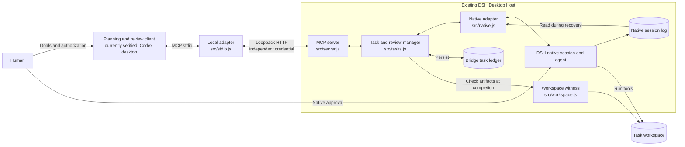

# cd-connect

[中文](README.md) | [English](README.en.md)

cd-connect connects a planning and review client to an existing DeepSeek Harness Desktop. You define a stage task on the ChatGPT/Codex side, DSH executes it within the existing native session, model, tool permissions, and human-approval boundary, and you decide whether to accept or request rework based on evidence from the **current run**.

The **c** stands for **ChatGPT**, and the **d** stands for **DeepSeek Harness**. The currently verified planning client is a Codex desktop session; the ChatGPT web and tunnel route has not been verified.

## Who it is for

- You already use DSH Desktop on the same Linux computer and want to hand stage goals from another conversation to it instead of copying prompts by hand.
- You need traceable task state, explicit acceptance criteria, and reviewable evidence from the current run.
- You accept that independent review decides whether the result passes: review may be performed by a human or by a user-authorized planning/review agent, and a model's claim of completion does not replace evidence. Native DSH approvals remain human decisions under the native policy.

It is not intended for unattended orchestration, execution across multiple machines, multi-tenant isolation, or an "exactly once" guarantee for external side effects. The first version targets a local single user.

## Current support

| Item | Current status |
| --- | --- |
| Operating system | Linux; Windows and macOS support is not claimed |
| Users and network | Local single user; the bridge listens on loopback only |
| DSH | DSH Desktop `0.2.1-rc.2`; only the `desktop` profile is accepted |
| Planning and review client | A Codex desktop session has been verified through local stdio MCP; other ChatGPT clients are unverified |
| Web/tunnel | A plausible route is documented, but it was not configured or verified and is not the default |
| Installation | Local source installation from a complete source tree; the source repository is `M1racleShih/cd-connect`, and no npm package is provided |
| Node.js | Declared `>=22.19.0`; dependency installation, default tests, and the recursive syntax check have been verified in clean environments on `22.19.0` and `24.18.0` |
| CI | `.github/workflows/ci.yml` covers dependency installation, default tests, and the recursive syntax check on Linux with `22.19.0` and `24.18.0`; see the repository Actions records for execution results |
| License | MIT, see [LICENSE](LICENSE); copyright 2026 Han-Qing Shi |

The bridge exposes nine MCP tools: eight task tools plus the read-only `bridge_health`. Task submission creates an ordinary native DSH session; continuation reuses it. cd-connect does not change the model, grant extra permissions, or approve actions for you in DSH.

## Quick start

Paths such as `/absolute/path/to/...` and `/tmp/...` below are placeholders; replace them with real paths. The normal path can be completed in one pass. See the [installation and maintenance guide](docs/INSTALLATION.md) (Chinese) for alternative installation routes, upgrades, uninstall, and recovery.

### 1. Prerequisites

You need Node.js `22.19.0` or newer, a working DSH Desktop `0.2.1-rc.2`, and a planning client that supports local stdio MCP. Put the complete source tree in any absolute directory, for example `/absolute/path/to/cd-connect`.

The source repository is [M1racleShih/cd-connect](https://github.com/M1racleShih/cd-connect). Installation uses a complete source tree; no npm package is provided. Obtain the source before following the installation steps below.

### 2. Install dependencies and run basic checks

```sh
cd /absolute/path/to/cd-connect   # example path
npm ci --ignore-scripts
npm test
npm run check
```

`--ignore-scripts` matches the current installation flow; the project is ESM JavaScript that runs directly and has no build step. `npm test` runs isolated tests by default; native-component tests that require a DSH source checkout are skipped, as explained in the [contributing guide](CONTRIBUTING.md) (Chinese). `npm run check` recursively syntax-checks every `.js` file under `src/`, `scripts/`, and `test/` (including `test/support/`); it is not a type check. CI covers the same basic checks and does not include native-component tests or real-desktop acceptance.

### 3. Enable the plugin in DSH

Open DSH's Plugins page, install the **absolute directory** of the source tree, and enable the `cd-connect` bundle. After activation it:

- serves MCP at `127.0.0.1:48763/mcp` (the `port` option overrides the port);
- writes an independent random credential for this activation to `cd-connect/connection.json` under the actual DSH home, with mode `0600`;
- stores the task ledger at `cd-connect/ledger/tasks.json` under the actual DSH home.

Local scripts default to `${DSH_HOME:-~/.dsh-linux}/cd-connect`; when the actual DSH home differs, set `CD_CONNECT_STATE_DIR` to it.

If loading fails, check for a port conflict, the DSH version, the profile type, and storage-directory permissions. See the [installation and maintenance guide](docs/INSTALLATION.md) (Chinese) for the full alternative route.

### 4. Connect MCP and confirm success

```sh
npm run health
codex mcp add cd-connect -- "$(command -v node)" /absolute/path/to/cd-connect/src/stdio.js
```

After registration, reload the local MCP connection in your client, then ask the **target conversation to call** `bridge_health` directly. A healthy result contains:

- `profile: "desktop"`, `bridge.version: "0.4.1"`, and `bridge.phase: 3`;
- `storage.healthy: true`;
- `capabilities.task_execution: true` and `task_storage: "durable_snapshot_v1"`;
- exactly nine tools in `capabilities.tools`, including `task_submit` and `bridge_health`.

`npm run health` and `npm run verify:native` only verify local SDK/HTTP/stdio paths. They are **not** acceptance by the target conversation. After plugin updates, reload the DSH plugin and refresh the client's MCP connection so the tool catalog is current.

### 5. Complete a minimal task

First create a genuinely disposable empty workspace and record the absolute path printed by the command. It must already exist, be an absolute path, and contain only what this task is allowed to change:

```sh
workspace=$(mktemp -d /tmp/cd-connect-hello.XXXXXX)
printf '%s\n' "$workspace"
```

Submit a specification like the following in natural language from the planning conversation; replace `<workspace>` with the actual absolute path printed above, not the placeholder:

> Submit one stage task through cd-connect. Use `<workspace>` (the actual absolute path printed above; do not submit the placeholder) as the workspace; goal: create `greeting.txt` containing exactly `hello` plus one newline; scope: only that file; out of scope: other files, external services, and publishing; constraints: use the existing model and native permissions, and do not use subagents; acceptance: reread the file and confirm it is the 6 bytes `hello\n`, then report the verification command, exit status, and SHA-256.

Then advance using the identifiers returned by the tools; do not skip steps:

1. Call `bridge_health` first and confirm the expected instance.
2. `task_submit` returns `task_id`, `revision`, `run.id`, and `event_cursor`. Keep them and retain the original request ID.
3. Call `task_wait` with the last consumed event cursor. A wait timeout means only that no event arrived during that interval; it is not completion.
4. Once the task is `awaiting_review`, call `task_evidence` with the current `run.id` starting at cursor 0 and consume **every page**. Also inspect the actual workspace file directly; model statements do not replace verification.
5. After checking scope and acceptance criteria, call `task_review` with the current revision, current `run_id`, a new request ID, `decision: "accepted"`, a concrete comment, and the evidence IDs from this run. Success means the task reaches `accepted` and is visible in the corresponding native DSH session.

**Concrete rework example**: if the file actually contains `hello world` plus a newline, first record `changes_requested` with "Expected `hello` plus a single newline; the current content has an extra `world`. Fix it, reread the file, and report the digest", citing the current evidence IDs. Then call `task_continue` with the current `run_id`, `revision`, and a new request ID, requiring the fix and re-verification in the same native session. Wait for the new run, review only the new run's evidence, and only then record `accepted`.

Execution completion (`execution_completed` / `awaiting_review`) and reviewer acceptance (`accepted`) are separate facts. See the [task workflow](docs/TASK_WORKFLOW.md) (Chinese) for field-level definitions, cursor rules, and recovery ordering.

## Why it is designed this way

Delegated instructions are sent to DSH through a fixed Markdown template preserving the goal, directory, scope, exclusions, constraints, and acceptance criteria. MCP inputs and the ledger retain structured specifications. Formatting does not turn written constraints into tool permission restrictions; native approvals and independent review still apply.

Forwarding a prompt proves only that a message was sent. It does not prove that the task was executed correctly, that the result is still valid at review time, or that a retry will not repeat a side effect. cd-connect therefore makes the unit of collaboration a **task** with goals, scope, exclusions, constraints, and acceptance criteria, rather than a chat message.

The planning and review side decides what to do and what counts as acceptance. The execution side reuses an existing DSH session, tools, and permissions, and is responsible for implementation and verification. Disconnects, restarts, timeouts, and late responses are treated as normal conditions: the bridge persists request identity, the actual session mapping, run IDs, and dispatch receipts. When an outcome cannot be proven, it inspects native logs instead of replaying automatically. Files can change after execution, so acceptance also checks evidence from the current run and the workspace witness captured at completion.

Authorization cannot be produced by a model report or another model output. DSH keeps native human approval, and the bridge only displays approval state; continuation and cancellation must be checked against the current run. The result is a task protocol with explicit boundaries, recovery, and review.

| Original problem | Design choice | Current implementation |
| --- | --- | --- |
| The two sides may understand goals and scope differently | Explicit task specification and independent review | [`protocol.js`](src/protocol.js), [`tasks.js`](src/tasks.js) |
| Receiving a request, finishing execution, and passing review are different | Separate lifecycle and review states | [`tasks.js`](src/tasks.js) |
| Retries and interruptions may duplicate side effects | Durable request deduplication, dispatch intent and receipts, manual recovery | [`storage.js`](src/storage.js), [`tasks.js`](src/tasks.js) |
| Old requests may affect later runs | Run IDs, revision checks, and synchronous native control guards | [`tasks.js`](src/tasks.js), [`native.js`](src/native.js) |
| Completed files may still change | Current-run evidence and workspace witnesses | [`workspace.js`](src/workspace.js), [`tasks.js`](src/tasks.js) |
| Cross-agent collaboration should not expand authority | Reuse native model and approvals, authenticate locally | [`native.js`](src/native.js), [`plugin.js`](src/plugin.js), [`server.js`](src/server.js) |



The plugin runs inside the existing Host, and the stdio adapter forwards only tools the Host actually advertises. Task state lives in the plugin; the bridge ledger and native logs serve different purposes. Directory ownership constrains tasks within one bridge store; it is not a system-wide write lock. See the [architecture guide](docs/ARCHITECTURE.md) (Chinese) for component responsibilities and protocol identities.

## Key limits and security boundaries

- **Approval stays in DSH**: `waiting_approval` displays the pending tool, call ID, and reason. The bridge has no approval endpoint and does not change models, permissions, or approval policy. Review the full command in DSH and decide there.
- **Completion is not acceptance**: native failures, cancellation, blocking, or token limits never become reviewable success. Even if the model claims completion, permission denial or incomplete evidence still prevents acceptance.
- **Cancellation has a confirmation boundary**: `accepted` only means the cancel request was accepted; it is `confirmed` only after the matched turn ends `aborted` and the agent is idle. Cancellation does not roll back changes or release directory ownership.
- **Unknown outcomes are not replayed**: after a restart, timeout, missing dispatch receipt, or uncertain cancellation, read the snapshot and use `task_recover` to reconcile native logs. Only an intent proven never attempted may be dispatched explicitly.
- **Exactly once is not guaranteed**: the bridge reduces duplicate-dispatch risk but cannot prove that arbitrary external side effects happen exactly once. It also cannot prevent or attribute concurrent writes by other processes.
- **Directory and evidence coverage is bounded**: within one bridge store, unaccepted tasks own the directory and its parent/child paths. The completion witness covers regular-file contents and modes, directory structure, and symlink target text, excludes `.git`, does not follow symlinks, and is capped at 20,000 entries and 128 MiB. External services, symlink target contents, and changes that were later reverted are outside its scope.
- **Workspace membership**: new tasks create or reuse a DSH sidebar workspace by the canonical `workspace` directory, then create and attach the session through native `workspaceId`; that directory also becomes the session cwd. Existing workspace titles are preserved; parent directories and display names are not used for matching. Attachment failure stops dispatch for human inspection instead of falling back to an ungrouped session. Existing task sessions are not migrated automatically.
- **The local boundary is not a sandbox**: loopback binding, a bearer credential, Host/Origin checks, and file modes protect a local single-user path; they do not isolate untrusted tenants. Do not expose the listener to the internet.
- **The ledger contains private content**: `tasks.json` stores task text, session mappings, and some tool evidence, while the connection file contains a local credential. Do not commit, upload, or publish the full ledger or connection file. Deleting the ledger removes deduplication and recovery evidence.

## Further documentation and contributing

The detailed guides, security policy, and contribution entry points below are currently **Chinese-only**; the linked CI workflow is configuration. This English README mirrors the support scope, commands, and limits, and marks the language difference here.

- [Installation, connection, upgrade, uninstall, and troubleshooting](docs/INSTALLATION.md)
- [Architecture, protocol identities, and control boundaries](docs/ARCHITECTURE.md)
- [Task submission, waiting, evidence, review, cancellation, and recovery](docs/TASK_WORKFLOW.md)
- [Contributing and validation layers](CONTRIBUTING.md)
- [Security policy, sensitive data, and private reporting](SECURITY.md)
- [Agent working entry point](AGENTS.md)
- [CI workflow](.github/workflows/ci.yml)

## Related projects

- [DeepSeek Harness](https://github.com/deepseek-ai/deepseek-harness): the upstream execution framework.
- [DSH Linux](https://github.com/M1racleShih/dsh-linux): the initial integration target.
- [dsh-chatgpt-bridge](https://github.com/jiezeng2004-design/dsh-chatgpt-bridge): a related bridge implementation.
- [codex-bridge](https://github.com/Fanch-hui/codex-bridge): a bridge supporting multiple executors.

## License

This project is licensed under the MIT License. The full text and copyright notice are in [LICENSE](LICENSE); copyright © 2026 Han-Qing Shi. Third-party dependencies retain their own licenses. See the support table above for the verified Node.js range and basic checks, and the [security policy](SECURITY.md) for private reporting.

cd-connect is an independent project and is not affiliated with or endorsed by OpenAI or DeepSeek.

## Experimental event coordinator

An explicitly started local program can move `task_wait` waiting outside model turns. It attempts at most one review turn in a dedicated Codex chat when the exact bound task/run/revision reaches `awaiting_review`. Ordinary progress and native approval waits start no model turns. This is a Linux, local single-user experiment using Codex app-server stdio with inherited native model and permission policies. Evidence review produces a recommendation; it never automatically accepts, continues, cancels, or recovers a task.

The CLI provides `init/run/status/stop/rearm/reconcile`. See the [event coordinator guide (Chinese)](docs/EVENT_COORDINATOR.md) for foreground startup, graceful stopping, dedicated chat ownership, uncertain-delivery reconciliation, and limits. Rearming the same binding preserves its cursor. Unknown lifecycle receipts require explicit read-only reconciliation; unresolved reviews on stop return nonzero, while historical terminal failures do not fail a successful new binding. Ordinary clients keep the existing `task_wait` workflow. No service installation or scheduled model polling is included; account-wide zero usage is not promised.
