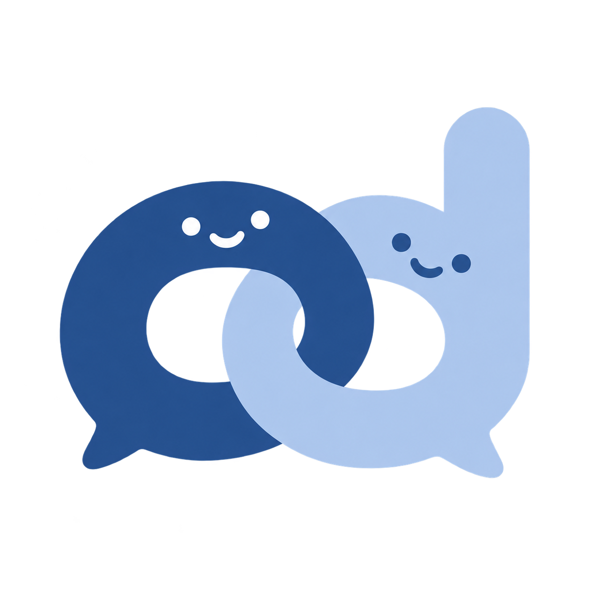
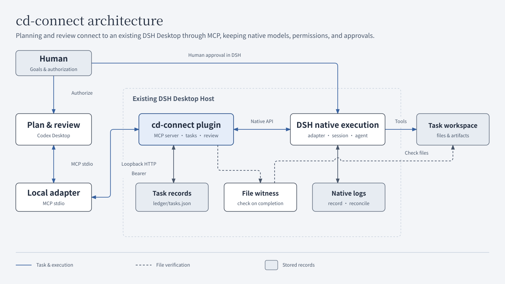

<p align="center"></p>

# cd-connect

[中文](README.md) · [English](README.en.md)

**Plan and review in Codex. Execute stage tasks in DSH Desktop.**

[Quick start](#quick-start) · [How it works](#how-it-works) · [Supported environment](#supported-environment) · [Documentation](#documentation) · [Contributing](CONTRIBUTING.en.md)

cd-connect connects a planning and review client to an existing DeepSeek Harness Desktop through MCP. You define the goal, scope, and acceptance criteria. DSH executes with its existing model, tool permissions, and human approvals. A human or user-authorized review agent then checks **evidence from the current run and the actual artifacts** before accepting the result or requesting rework.

The **c** stands for ChatGPT and the **d** for DeepSeek Harness. The verified client is a Codex desktop session, used by one user on the same Linux computer.

<a id="who-it-is-for"></a>

## Highlights

- **Explicit task handoff**: submit the goal, workspace, scope, exclusions, constraints, and acceptance criteria. Each task creates an ordinary native DSH session; rework continues in that session.
- **Review with evidence**: read the current run's assistant messages, tool calls, and results, then inspect the actual files. Execution completion and review acceptance are recorded separately.
- **Recovery after interruptions**: request IDs, run records, and dispatch receipts persist. Unknown outcomes require native-log inspection first; they are never replayed automatically.
- **Native controls**: the bridge keeps the model, tool permissions, and human approvals. Continuation and cancellation check the current run and revision.

## How it works



The plugin runs inside the existing DSH Desktop Host. The local stdio adapter forwards only tools that the Host advertises. The bridge stores task records; DSH stores native logs. At completion, a workspace witness captures digests of file contents, modes, directory structure, and symlink target text so later review can detect changes. [Component responsibilities](docs/ARCHITECTURE.en.md) · [Diagram sources and maintenance](docs/DIAGRAMS.en.md)

A task proceeds in this order:

1. **Submit**: call `bridge_health`, then `task_submit` with a clear specification. Save the task ID, run ID, revision, and event cursor.
2. **Wait**: consume event pages with `task_wait`. A timeout means no new event arrived during that wait. At `waiting_approval`, a human reviews and approves or rejects the operation in DSH.
3. **Review**: at `awaiting_review`, read every `task_evidence` page for the current run, inspect the artifacts, then record a decision with `task_review`.
4. **Rework or accept**: record `changes_requested` before using `task_continue` in the same session. Review the new run after it completes. Record `accepted` only when the result passes review.

<a id="current-support"></a>

## Supported environment

| Item | Current support |
| --- | --- |
| Version and system | cd-connect `0.5.0`; Linux, local single user, loopback network |
| Execution host | DSH Desktop `0.2.1-rc.2`, `desktop` profile only |
| Planning and review client | A Codex desktop session through local stdio MCP has been verified |
| Node.js | `>=22.19.0`; basic installation, default tests, and recursive syntax checks were verified in clean environments with `22.19.0` and `24.18.0` |
| Installation | Complete source tree; no npm package is provided, and `package.json` keeps `private: true` |
| CI | Linux with Node.js `22.19.0` and `24.18.0`; see [Actions](https://github.com/M1racleShih/cd-connect/actions/workflows/ci.yml) for actual results |
| Unverified | Windows/macOS, other ChatGPT clients, web and tunnel routes |

The project does not provide cross-machine execution, multi-tenant isolation, unattended automatic recovery, or exactly-once guarantees for external side effects.

## Quick start

You need a working DSH Desktop, a Node.js version listed above, and a client that supports local stdio MCP. All `/absolute/path/to/...` and `/tmp/...` paths below are **examples**; replace them with actual paths. For upgrades, uninstall, the alternative Desktop CLI installation, and troubleshooting, see [installation and maintenance](docs/INSTALLATION.en.md).

### 1. Get the source and check the environment

```sh
git clone https://github.com/M1racleShih/cd-connect.git
cd cd-connect
npm ci --ignore-scripts
npm test
npm run check
```

The project runs directly as ESM JavaScript with no build step. Default tests use isolated fixtures and skip native-component tests that require DSH source. `check` recursively checks JavaScript syntax in `src/`, `scripts/`, and `test/`; it does not check types. CI covers basic installation and these two checks, plus bilingual documentation checks. See [contributing](CONTRIBUTING.en.md) for validation scope.

### 2. Enable the plugin in DSH

Open the DSH Plugins page, install the **absolute path** to the source root, and enable the `cd-connect` bundle. Once loaded, the plugin:

- Serves MCP at `http://127.0.0.1:48763/mcp`; the native `port` setting can override the port.
- Writes `cd-connect/connection.json` under the actual DSH home, with a random credential for this activation and mode `0600`.
- Persists task records in `cd-connect/ledger/tasks.json`.

Local scripts default to `${DSH_HOME:-~/.dsh-linux}/cd-connect`. If the actual location differs, set `CD_CONNECT_STATE_DIR` to the corresponding `cd-connect` directory.

### 3. Connect Codex and confirm tool access

Run from the source root, replacing the example path:

```sh
npm run health
codex mcp add cd-connect -- "$(command -v node)" /absolute/path/to/cd-connect/src/stdio.js
```

Refresh the client's MCP connection, then have the **target Codex session call** `bridge_health` directly. Confirm the expected instance and these values:

- `profile: "desktop"`, `bridge.version: "0.5.0"`, `bridge.phase: 3`;
- `storage.healthy: true`, `capabilities.task_execution: true`;
- `capabilities.task_storage: "durable_snapshot_v1"`, with exactly nine tools in `capabilities.tools`.

`npm run health` and the optional `npm run verify:native` check local SDK/HTTP/stdio paths. Tool discovery and calls from the target session must be checked in that session. After a plugin upgrade, reload the plugin and refresh the client connection.

### 4. Complete a small task

Create a disposable empty workspace and save the absolute path printed by this command:

```sh
workspace=$(mktemp -d /tmp/cd-connect-hello.XXXXXX)
printf '%s\n' "$workspace"
```

Replace `<workspace>` below with that actual path, then ask the planning client:

> Submit a stage task through cd-connect. Use `<workspace>` as workspace; goal: create `greeting.txt` containing exactly `hello` and one newline; scope: modify only that file; out_of_scope: other files, external services, and publishing; constraints: use the existing model and native permissions, with no subagents; acceptance: reread the file and verify 6 bytes, `hello\n`, then report the verification command, exit status, and SHA-256.

Wait and review as described above. Read every evidence page starting at cursor 0 for the current `run.id`. Supply the current `expected_revision`, `run_id`, a new `request_id`, a specific comment, and current-run `evidence_ids` to `task_review`.

If the file contains `hello world` and a newline, record specific `changes_requested`, then ask the same session to correct and reread it. Review only the new run's evidence. Success means the artifacts meet the specification, the task appears in its corresponding DSH session, and review leaves it `accepted`. [Full fields and recovery procedure](docs/TASK_WORKFLOW.en.md)

<a id="why-it-is-designed-this-way"></a>

## Why this design

Forwarding a prompt proves that a message was sent. cd-connect also needs to establish which task ran, which records belong to that run, whether files changed before review, and whether an interrupted request already executed.

The bridge therefore stores structured specifications and stable request IDs. A fixed Markdown template presents each requirement to DSH. Each run gets its own ID, and evidence and review are bound to it. Dispatch intent and receipts are saved on either side of the native call. Unknown execution outcomes require snapshot and native-log inspection first.

Written requirements do not grant tool permissions. The execution side implements and verifies; the review side decides from evidence; DSH retains human approvals under its native policy. [Architecture and design details](docs/ARCHITECTURE.en.md)

<a id="key-limits-and-security-boundaries"></a>

## Usage boundaries

- **Approve in DSH**: `waiting_approval` displays the tool, call ID, and reason. Inspect the full command in DSH. The bridge has no approval endpoint.
- **Review after completion**: neither `execution_completed` nor `awaiting_review` means `accepted`. Native failures, cancellation, blocking, token limits, permission denial, or insufficient evidence cannot be accepted as success.
- **Wait for cancellation confirmation**: a cancellation request marked `accepted` has only been received. It becomes `confirmed` after the matched turn ends `aborted` and becomes idle. Cancellation does not roll back changes or release directory ownership automatically.
- **Inspect unknown outcomes**: after a restart, timeout, or missing receipt, call `task_get`, then `task_recover` with `inspect`. Only an intent durably proven never attempted can be explicitly sent with `dispatch_prepared`.
- **File checks have limits**: within one bridge store, unaccepted tasks own the same directory and parent/child paths; this is not a system-wide write lock. Workspace witnesses exclude `.git`, do not follow symlinks, and are capped at 20000 entries and 128 MiB. They cannot prevent concurrent writes, attribute other processes' changes, or prove external-service state, symlink target contents, or changes later reverted.
- **Group sessions by workspace**: new tasks create or reuse a DSH sidebar workspace by canonical directory and attach sessions through `workspaceId`, which determines cwd. Existing names stay; parent directories and display names are not matched. Attachment failure stops dispatch for human inspection. Existing sessions are not migrated automatically.
- **Keep private data local**: `connection.json` contains credentials; `tasks.json` contains task text, session mappings, and some tool evidence. Do not commit or publish them. Deleting task records removes deduplication and recovery evidence. Loopback binding, Bearer authentication, and file modes do not provide multi-tenant isolation; do not expose the service to the internet.

## Experimental event coordinator

An explicitly started local program can call `task_wait` outside model turns. It attempts at most one wake-up of a dedicated Codex review chat when the bound instance, task, run, and revision reach `awaiting_review`. Ordinary progress and approval waits start no model turns.

It uses experimental Codex app-server stdio with inherited native model and permission policies. It produces review recommendations without automatically accepting, continuing, cancelling, or recovering tasks. The CLI provides `init/run/status/stop/rearm/reconcile`; it installs no background service or scheduled model polling and does not guarantee zero account usage. See the [event coordinator guide](docs/EVENT_COORDINATOR.en.md) for dedicated chat ownership, stopping, cursors, and uncertain sends. Ordinary MCP clients keep their existing wait workflow.

<a id="further-documentation-and-contributing"></a>

## Documentation

All project guides have Chinese and English versions, with a language switch at the top of each page.

| Topic | 中文 | English |
| --- | --- | --- |
| Version changes and compatibility | [更新记录](CHANGELOG.md) | [Changelog](CHANGELOG.en.md) |
| Install, connect, upgrade, and troubleshoot | [安装与维护](docs/INSTALLATION.md) | [Installation](docs/INSTALLATION.en.md) |
| Components, protocol identities, and control boundaries | [架构说明](docs/ARCHITECTURE.md) | [Architecture](docs/ARCHITECTURE.en.md) |
| Submit, inspect evidence, review, cancel, and recover | [任务协议](docs/TASK_WORKFLOW.md) | [Task workflow](docs/TASK_WORKFLOW.en.md) |
| Optional local review wake-up | [事件协调器](docs/EVENT_COORDINATOR.md) | [Event coordinator](docs/EVENT_COORDINATOR.en.md) |
| Diagram sources, colors, and redraws | [图表维护](docs/DIAGRAMS.md) | [Diagram maintenance](docs/DIAGRAMS.en.md) |
| Develop, validate, and synchronize documentation | [贡献指南](CONTRIBUTING.md) | [Contributing](CONTRIBUTING.en.md) |
| Private data and vulnerability reporting | [安全策略](SECURITY.md) | [Security policy](SECURITY.en.md) |
| Agent working instructions | [AGENTS](AGENTS.md) | [AGENTS (English)](AGENTS.en.md) |

Read the contribution guide before making changes, and choose checks for the affected behavior. [CI configuration](.github/workflows/ci.yml) covers basic installation, default tests, recursive syntax checks, and bilingual documentation checks. Native-component tests and real-desktop acceptance run separately.

## Related projects

- [DeepSeek Harness](https://github.com/deepseek-ai/deepseek-harness): upstream execution framework.
- [DSH Linux](https://github.com/M1racleShih/dsh-linux): initial integration target.
- [dsh-chatgpt-bridge](https://github.com/jiezeng2004-design/dsh-chatgpt-bridge): related bridge implementation.
- [codex-bridge](https://github.com/Fanch-hui/codex-bridge): bridge implementation supporting multiple executors.

## License

[MIT](LICENSE), copyright © 2026 Han-Qing Shi. Third-party dependencies retain their own licenses. cd-connect is an independent project and is not affiliated with or endorsed by OpenAI or DeepSeek.
