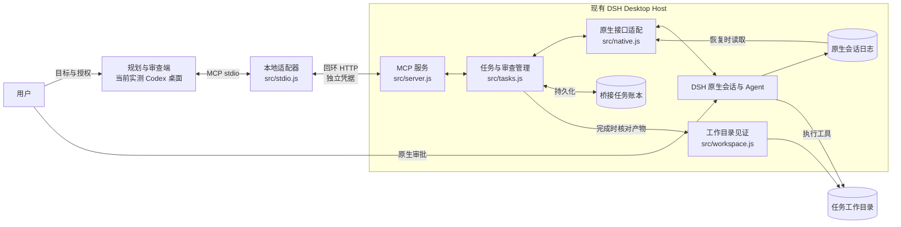

# cd-connect

[中文](README.md) | [English](README.en.md)

cd-connect 把规划与审查端连接到现有的 DeepSeek Harness Desktop：你在 ChatGPT/Codex 一侧定义阶段任务，DSH 在原有的原生会话、模型、工具权限和人工审批边界内执行，你再依据**当前运行**的证据决定通过或返工。

项目名中的 **c** 代表 **ChatGPT**，**d** 代表 **DeepSeek Harness**。当前实测的规划端是 Codex 桌面会话；ChatGPT 网页与隧道方案尚未验证。

## 它适合谁

- 你已经在同一台 Linux 电脑上使用 DSH Desktop，希望把另一个会话中的阶段目标交给它执行，而不是手工复制提示词。
- 你需要可追踪的任务状态、明确的验收条件和可核对的当前运行证据。
- 你接受执行完成后由独立审查决定是否通过：审查可由人或用户授权的规划/审查 Agent 执行，模型自述完成不能替代证据；DSH 原生审批仍由人按原生策略决定。

它不适合需要无人值守调度、跨多台机器执行、多租户隔离或“外部副作用恰好一次”保证的场景。第一版只面向本地单用户。

## 当前支持范围

| 项目 | 当前状态 |
| --- | --- |
| 操作系统 | Linux；未声明 Windows 或 macOS 支持 |
| 用户与网络 | 本机单用户；桥接仅监听回环地址 |
| DSH | DSH Desktop `0.2.1-rc.2`；只接受 `desktop` profile |
| 规划与审查端 | 已实测 Codex 桌面会话通过本地 stdio MCP 调用；其他 ChatGPT 客户端未验证 |
| 网页/隧道 | 文档给出可行方向，但未配置、未验证，不属于默认路径 |
| 安装方式 | 从完整源码目录安装；源码仓库为 `M1racleShih/cd-connect`，当前不提供 npm 包 |
| Node.js | 声明 `>=22.19.0`；基础依赖安装、默认测试与递归语法检查已在干净环境用 `22.19.0`、`24.18.0` 验证 |
| CI | `.github/workflows/ci.yml` 覆盖 Linux 上 `22.19.0`、`24.18.0` 的依赖安装、默认测试与递归语法检查；执行结果以仓库 Actions 记录为准 |
| 许可 | MIT，见 [LICENSE](LICENSE)；版权 2026 Han-Qing Shi |

桥接提供九个 MCP 工具：八个任务工具，加上只读的 `bridge_health`。任务提交会创建普通原生 DSH 会话；续写复用同一会话。cd-connect 不更换模型，不授予额外权限，也不替你在 DSH 中批准操作。

## 快速开始

以下命令中的 `/absolute/path/to/...` 与 `/tmp/...` 都是示例占位，请替换为实际路径。正常路径可以一次走完；完整安装替代路径、升级、卸载和故障恢复见[安装与维护](docs/INSTALLATION.md)。

### 1. 准备环境

需要 Node.js `22.19.0` 或更新版本、可用的 DSH Desktop `0.2.1-rc.2`，以及支持本地 stdio MCP 的规划端。先把完整源码放在任意绝对目录，例如 `/absolute/path/to/cd-connect`。

源码仓库为 [M1racleShih/cd-connect](https://github.com/M1racleShih/cd-connect)，采用完整源码目录安装，不提供 npm 包。获取源码后，再执行下面的安装步骤。

### 2. 安装依赖并做基础检查

```sh
cd /absolute/path/to/cd-connect   # 示例路径
npm ci --ignore-scripts
npm test
npm run check
```

`--ignore-scripts` 与当前安装流程一致；项目是直接运行的 ESM JavaScript，没有构建步骤。`npm test` 默认运行隔离测试；需要 DSH 源码的原生组件测试会跳过，说明见[贡献指南](CONTRIBUTING.md)。`npm run check` 递归检查 `src/`、`scripts/` 和 `test/`（含 `test/support/`）中的 `.js` 文件，只做语法检查，不是类型检查。CI 配置覆盖同样的基础检查，不包含原生组件测试或真实桌面验收。

### 3. 在 DSH 中启用插件

打开 DSH 的“插件”页面，安装上述源码的**绝对目录**，启用 `cd-connect` bundle。插件加载后会：

- 在 `127.0.0.1:48763/mcp` 启动回环 MCP 服务（`port` 配置可覆盖端口）；
- 在实际 DSH home 下的 `cd-connect/connection.json` 写入本次加载的独立随机凭据，文件权限为 `0600`；
- 在实际 DSH home 下的 `cd-connect/ledger/tasks.json` 保存任务账本。

本地脚本默认查找 `${DSH_HOME:-~/.dsh-linux}/cd-connect`；实际 DSH home 不同时，设置 `CD_CONNECT_STATE_DIR` 指向它。

如果加载失败，先检查端口占用、DSH 版本、profile 类型和存储目录权限。完整替代路径见[安装与维护](docs/INSTALLATION.md)。

### 4. 连接 MCP 并确认成功标志

```sh
npm run health
codex mcp add cd-connect -- "$(command -v node)" /absolute/path/to/cd-connect/src/stdio.js
```

注册后按客户端方式重新加载本地 MCP 连接，再让**目标会话直接调用** `bridge_health`。正常结果应包含：

- `profile: "desktop"`，`bridge.version: "0.4.1"`，`bridge.phase: 3`；
- `storage.healthy: true`；
- `capabilities.task_execution: true`、`task_storage: "durable_snapshot_v1"`；
- `capabilities.tools` 中恰好九个工具，包含 `task_submit` 与 `bridge_health`。

`npm run health` 和 `npm run verify:native` 只验证本机 SDK/HTTP/stdio 路径，**不是**目标会话的验收。更新插件后需让 DSH 重新加载插件，并刷新客户端的 MCP 连接以更新工具目录。

### 5. 完成一次最小任务

先创建一个真正的一次性空工作区，并记录命令输出的绝对路径。该目录必须已存在、是绝对路径，并只包含本次允许修改的内容：

```sh
workspace=$(mktemp -d /tmp/cd-connect-hello.XXXXXX)
printf '%s\n' "$workspace"
```

在规划端会话中用自然语言提交类似下面的规格；把 `<workspace>` 换成上一步输出的实际绝对路径，不要原样提交占位符：

> 请通过 cd-connect 提交一个阶段任务。workspace 为 `<workspace>`（上一步输出的实际绝对路径，不要原样使用占位符）；goal 是创建 `greeting.txt`，内容恰为 `hello` 加一个换行；scope 仅允许修改该文件；out_of_scope 为其他文件、外部服务与发布；constraints 为使用现有模型和原生权限、不使用子 agent；acceptance 为重新读取文件得到 6 字节 `hello\n`，并报告校验命令、退出状态和 SHA-256。

随后按工具返回的标识推进，不要跳步：

1. 先 `bridge_health`，确认连的是预期实例。
2. `task_submit` 返回 `task_id`、`revision`、`run.id` 和 `event_cursor`。保存这些值，保留提交时的请求编号。
3. 用最后消费的事件游标调用 `task_wait`。等待超时只表示这段时间没有新事件，不代表执行完成。
4. 进入 `awaiting_review` 后，用当前 `run.id` 从游标 0 开始调用 `task_evidence`，消费**全部页**。同时直接检查工作区中的实际文件；模型陈述不能替代验证。
5. 核对范围和验收条件后调用 `task_review`，携带当前版本、当前 `run_id`、新请求编号、`decision: "accepted"`、具体说明和本轮证据编号。成功标志是任务状态最终为 `accepted`，且任务确实出现在对应的 DSH 原生会话中。

**具体返工示例**：若文件实际内容是 `hello world` 加换行，先以 `changes_requested` 记录“应为 `hello` 加单个换行，当前多出 `world`；请修正后重新读取并报告摘要”，附上当前证据编号；再用当前 `run_id`、`revision` 和新请求编号调用 `task_continue`，要求在同一原生会话中修正并重新验证；等待新运行完成后，只审查新运行的证据，最后才记录 `accepted`。

执行完成（`execution_completed` / `awaiting_review`）与验收通过（`accepted`）是两个独立事实。字段级定义、游标规则和恢复顺序见[任务协议](docs/TASK_WORKFLOW.md)。

## 为什么这样设计

仅转发一段提示词，只能证明消息被发送；它不能证明任务被正确执行，不能证明结果在审查时仍然有效，也不能证明某次重试不会重复产生副作用。因此 cd-connect 把协作单位定义为包含目标、范围、排除项、约束和验收条件的**任务**，而不是一条聊天消息。

规划与审查端决定要完成什么、依据什么接受；执行端复用已有 DSH 会话、工具和权限，负责实现与验证。断线、重启、超时和迟到响应被视为正常情况：桥接保存请求身份、实际会话映射、运行编号和派发回执；无法证明结果时先核对原生日志，而不是自动重放。文件可能在执行结束后被改动，所以验收还要关联当前运行的证据与完成时的目录见证。

授权不能由模型报告或另一段模型输出产生。DSH 保留原生人工审批，桥接只展示审批状态；续写与取消必须核对当前运行。由此形成的是一个边界明确、可恢复、可审查的任务协议。

| 原始问题 | 设计选择 | 当前实现 |
| --- | --- | --- |
| 双方对目标与范围理解不同 | 显式任务规格与独立验收 | [`protocol.js`](src/protocol.js)、[`tasks.js`](src/tasks.js) |
| 接收请求、执行结束与验收通过不同 | 分离生命周期与审查状态 | [`tasks.js`](src/tasks.js) |
| 重试和中断可能重复产生副作用 | 持久请求去重、派发意图与回执、手动恢复 | [`storage.js`](src/storage.js)、[`tasks.js`](src/tasks.js) |
| 旧请求可能影响后续运行 | 运行编号、版本校验与原生同步控制检查 | [`tasks.js`](src/tasks.js)、[`native.js`](src/native.js) |
| 完成后的文件仍可能被修改 | 当前运行证据与文件见证 | [`workspace.js`](src/workspace.js)、[`tasks.js`](src/tasks.js) |
| 跨 agent 协作不应扩大权限 | 复用原生模型和审批，独立本地认证 | [`native.js`](src/native.js)、[`plugin.js`](src/plugin.js)、[`server.js`](src/server.js) |



插件运行在现有 Host 内，stdio 适配器只转发 Host 实际提供的工具；任务状态在插件内，桥接账本与原生日志职责不同。目录占用只约束同一桥接存储中的任务，不是系统级写锁。组件职责与协议身份详见[架构说明](docs/ARCHITECTURE.md)。

## 关键限制与安全边界

- **审批仍在 DSH**：`waiting_approval` 只展示待审批的工具、调用编号和原因；桥接没有批准接口，也不更改模型、权限或审批策略。请在 DSH 界面核对完整命令后自行决定。
- **完成不等于通过**：原生执行失败、取消、阻塞或 token 上限不会进入可验收状态。即使模型声明完成，权限拒绝或证据不完整仍不能验收。
- **取消有确认边界**：`accepted` 只表示取消请求被接受；匹配轮次以 `aborted` 结束且空闲后才是 `confirmed`。取消不回滚修改，也不自动释放目录占用。
- **未知结果不重放**：重启、超时、派发回执缺失或取消结果不明时，先读取快照并用 `task_recover` 核对原生日志。只有能证明尚未尝试的意图才能显式派发。
- **不保证恰好一次**：桥接降低重复派发风险，但不能证明任意外部副作用恰好一次；也不能阻止或归属执行期间其他进程的写入。
- **目录与证据范围有限**：同一桥接存储中，未验收任务占用同目录及父子目录；完成时见证覆盖普通文件内容/权限、目录结构和符号链接目标文本，排除 `.git`，不跟随符号链接，上限为 20000 个条目与 128 MiB。外部服务、链接目标内容和修改后又恢复的历史不在见证范围内。
- **workspace 只是磁盘 cwd**：提交的目录会成为新原生会话的当前目录，但当前版本不会注册或关联 DSH 侧栏工作区；新会话可能出现在未分组列表中。请保存 `session_id` 并按任务映射查找。
- **本地边界并非沙箱**：回环监听、Bearer 凭据、Host/Origin 检查和文件权限只保护本机单用户路径，不构成不可信多租户隔离。不要把监听公开到互联网。
- **账本含私有内容**：`tasks.json` 保存任务正文、会话映射与部分工具证据，连接文件含本机凭据。不要提交、上传或公开整份账本/连接文件；删除账本会失去去重与恢复依据。

## 深入文档与贡献

以下深入文档与贡献入口当前均为中文；英文 README 同步了支持范围、命令和限制，并在此明示语言差异。

- [安装、连接、升级、卸载与故障恢复](docs/INSTALLATION.md)
- [架构、协议身份与控制边界](docs/ARCHITECTURE.md)
- [任务提交、等待、证据、审查、取消与恢复](docs/TASK_WORKFLOW.md)
- [贡献指南与验证分层](CONTRIBUTING.md)
- [安全策略、敏感数据与私下报告](SECURITY.md)
- [Agent 工作入口](AGENTS.md)
- [CI 工作流](.github/workflows/ci.yml)

## 相关项目

- [DeepSeek Harness](https://github.com/deepseek-ai/deepseek-harness)：上游执行框架。
- [DSH Linux](https://github.com/M1racleShih/dsh-linux)：第一版接入目标。
- [dsh-chatgpt-bridge](https://github.com/jiezeng2004-design/dsh-chatgpt-bridge)：相关桥接实现参考。
- [codex-bridge](https://github.com/Fanch-hui/codex-bridge)：多执行器桥接实现参考。

## 许可

本项目采用 MIT 许可证，完整文本与版权声明见 [LICENSE](LICENSE)，版权 © 2026 Han-Qing Shi。第三方依赖保留各自的许可；支持的 Node.js 版本与基础验证范围见上文，安全报告方式见[安全策略](SECURITY.md)。

cd-connect 是独立项目，与 OpenAI 或 DeepSeek 不存在官方隶属或背书关系。
