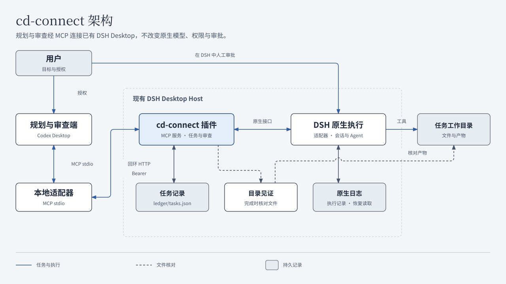

<p align="center"></p>

# cd-connect

[中文](README.md) · [English](README.en.md)

**在 Codex 中规划和审查，让 DSH Desktop 执行阶段任务。**

[快速开始](#快速开始) · [工作方式](#工作方式) · [支持范围](#支持范围) · [文档](#文档) · [贡献](CONTRIBUTING.md)

cd-connect 通过 MCP 连接规划与审查端和现有的 DeepSeek Harness Desktop。你定义目标、范围和验收条件，DSH 使用原有模型、工具权限和人工审批执行；执行结束后，由人或用户授权的审查 Agent 检查**当前运行的证据和实际产物**，决定通过或返工。

项目名中的 **c** 代表 ChatGPT，**d** 代表 DeepSeek Harness。目前实测客户端为 Codex 桌面会话，面向同一台 Linux 电脑上的单用户使用。

<a id="它适合谁"></a>

## 核心能力

- **明确交接任务**：提交目标、工作目录、允许范围、排除事项、约束和验收条件，创建普通 DSH 原生会话；返工沿用该会话。
- **按证据审查**：读取本轮助手消息、工具调用和结果，核对实际文件。执行结束与审查通过分别记录。
- **中断后可核对**：持久保存请求编号、运行记录和派发回执。结果不明时先查原生日志，不自动重发。
- **保留原生控制**：不更换模型、不扩大工具权限、不代替人工审批；续写与取消都检查当前运行和版本。

## 工作方式



插件运行在已有 DSH Desktop Host 内；本地 stdio 适配器只转发 Host 实际提供的工具。桥接保存任务记录，DSH 保存原生日志；完成时的目录见证记录文件内容、权限、目录结构与符号链接目标文本的摘要，供审查时核对变化。[组件职责](docs/ARCHITECTURE.md) · [图表源文件与维护](docs/DIAGRAMS.md)

一次任务按以下顺序推进：

1. **提交**：先检查 `bridge_health`，再用 `task_submit` 提交明确规格，保存任务编号、运行编号、版本和事件游标。
2. **等待**：用 `task_wait` 消费事件页；超时只表示本次没有新事件。遇到 `waiting_approval`，由人在 DSH 中核对并批准或拒绝。
3. **审查**：进入 `awaiting_review` 后，读取当前运行的全部 `task_evidence` 页，检查实际产物，再用 `task_review` 记录决定。
4. **返工或通过**：需要修正时先记录 `changes_requested`，再用 `task_continue` 在同一会话继续；新运行完成后重新审查。通过时才记录 `accepted`。

<a id="当前支持范围"></a>

## 支持范围

| 项目 | 当前支持 |
| --- | --- |
| 版本与系统 | cd-connect `0.5.0`；Linux，本机单用户，回环网络 |
| 执行端 | DSH Desktop `0.2.1-rc.2`，仅 `desktop` profile |
| 规划与审查端 | 已实测 Codex 桌面会话通过本地 stdio MCP 调用 |
| Node.js | `>=22.19.0`；基础安装、默认测试与递归语法检查已在干净环境用 `22.19.0`、`24.18.0` 验证 |
| 安装 | 从完整源码目录安装；不提供 npm 包，`package.json` 保持 `private: true` |
| CI | Linux 上的 Node.js `22.19.0`、`24.18.0`；实际结果见 [Actions](https://github.com/M1racleShih/cd-connect/actions/workflows/ci.yml) |
| 尚未验证 | Windows/macOS、其他 ChatGPT 客户端、网页与隧道路径 |

本项目不提供跨机器执行、多租户隔离、无人值守自动恢复或外部副作用恰好一次的保证。

## 快速开始

需要可用的 DSH Desktop、符合上表的 Node.js，以及支持本地 stdio MCP 的客户端。以下 `/absolute/path/to/...` 和 `/tmp/...` 均为**示例路径**，请替换为实际路径。升级、卸载、Desktop CLI 替代安装和故障处理见[安装与维护](docs/INSTALLATION.md)。

### 1. 获取源码并检查环境

```sh
git clone https://github.com/M1racleShih/cd-connect.git
cd cd-connect
npm ci --ignore-scripts
npm test
npm run check
```

项目是直接运行的 ESM JavaScript，无构建步骤。默认测试使用隔离夹具，会跳过需要 DSH 源码的原生组件测试；`check` 递归检查 `src/`、`scripts/`、`test/` 的 JavaScript 语法，不做类型检查。CI 覆盖基础安装和这两项检查，并运行双语文档检查；验证范围见[贡献指南](CONTRIBUTING.md)。

### 2. 在 DSH 中启用插件

打开 DSH 的“插件”页面，安装源码根目录的**绝对路径**，启用 `cd-connect` bundle。加载成功后，插件会：

- 在 `http://127.0.0.1:48763/mcp` 提供 MCP 服务；可用原生 `port` 配置改端口。
- 在实际 DSH home 下写入 `cd-connect/connection.json`，保存本次加载的随机凭据，权限为 `0600`。
- 在 `cd-connect/ledger/tasks.json` 持久保存任务记录。

本地脚本默认查找 `${DSH_HOME:-~/.dsh-linux}/cd-connect`。实际位置不同时，设置 `CD_CONNECT_STATE_DIR` 指向对应的 `cd-connect` 目录。

### 3. 连接 Codex 并确认工具可用

从源码根目录运行，替换示例路径：

```sh
npm run health
codex mcp add cd-connect -- "$(command -v node)" /absolute/path/to/cd-connect/src/stdio.js
```

刷新客户端的 MCP 连接后，让**目标 Codex 会话直接调用** `bridge_health`。确认连接的是预期实例，且返回：

- `profile: "desktop"`、`bridge.version: "0.5.0"`、`bridge.phase: 3`；
- `storage.healthy: true`、`capabilities.task_execution: true`；
- `capabilities.task_storage: "durable_snapshot_v1"`，`capabilities.tools` 恰好包含九个工具。

`npm run health` 与可选的 `npm run verify:native` 只验证本地 SDK/HTTP/stdio 路径。目标会话是否能发现和调用工具，要在该会话中确认。插件升级后需重新加载插件并刷新客户端连接。

### 4. 完成一个小任务

创建一次性空工作目录，记下输出的绝对路径：

```sh
workspace=$(mktemp -d /tmp/cd-connect-hello.XXXXXX)
printf '%s\n' "$workspace"
```

将下文的 `<workspace>` 换成该实际路径，再向规划端提出请求：

> 请通过 cd-connect 提交阶段任务。workspace 为 `<workspace>`；goal 是创建 `greeting.txt`，内容恰为 `hello` 加一个换行；scope 仅允许修改该文件；out_of_scope 为其他文件、外部服务与发布；constraints 为使用现有模型和原生权限、不使用子 agent；acceptance 为重新读取文件得到 6 字节 `hello\n`，并报告校验命令、退出状态和 SHA-256。

按上文流程等待并审查。读取证据时，从当前 `run.id` 的游标 0 开始消费全部页；调用 `task_review` 时携带当前 `expected_revision`、`run_id`、新 `request_id`、具体说明及本轮 `evidence_ids`。

若文件写成了 `hello world` 加换行，先记录具体的 `changes_requested`，再要求同会话修正并重新读取验证；只审查新运行的证据。成功标志是产物符合规格、任务出现在对应 DSH 会话中，且审查后状态为 `accepted`。[完整字段与恢复步骤](docs/TASK_WORKFLOW.md)

## 为什么这样设计

转发提示词只能证明消息已发送。cd-connect 还要回答：执行的是哪项任务、哪些记录属于本轮、文件在审查时是否变化，以及中断后的请求是否已经执行。

为此，桥接保存结构化规格和稳定请求编号，用固定 Markdown 模板向 DSH 逐项传达要求；每次运行单独编号，证据与审查绑定该运行；派发前后分别保存意图和回执。无法确定执行结果时，先核对快照与原生日志。

这些文字要求不会变成额外的工具权限。执行方负责实现和验证，审查方根据证据决定是否通过，DSH 按原生策略保留人工审批。[架构与设计细节](docs/ARCHITECTURE.md)

<a id="关键限制与安全边界"></a>

## 使用边界

- **审批在 DSH 中完成**：`waiting_approval` 展示工具、调用编号和原因；完整命令需在 DSH 界面核对。桥接没有批准接口。
- **完成后仍需审查**：`execution_completed` 和 `awaiting_review` 都不是 `accepted`。执行失败、取消、阻塞、token 上限、权限拒绝或证据不足时不能按成功验收。
- **取消需等待确认**：取消请求的 `accepted` 仅表示收到请求；匹配轮次以 `aborted` 结束并空闲后才是 `confirmed`。取消不回滚修改，不自动释放目录占用。
- **未知结果先核对**：重启、超时或回执缺失时，先 `task_get`，再 `task_recover` + `inspect`。只有记录证明尚未尝试的意图才可用 `dispatch_prepared` 显式派发。
- **文件检查有范围**：同一桥接存储中，未验收任务占用同目录及父子目录；这不是系统级写锁。目录见证排除 `.git`，不跟随符号链接，上限为 20000 个条目、128 MiB。它不能阻止并发写入、归属其他进程的修改，或证明外部服务、链接目标内容及修改后又恢复的历史。
- **会话按工作目录归组**：新任务按规范目录创建或复用 DSH 侧栏工作区，通过 `workspaceId` 关联会话并确定 cwd。保留已有名称；不按父目录或显示名称匹配。关联失败会停止派发并要求人工核对；旧会话不自动迁移。
- **私有数据留在本机**：`connection.json` 含凭据，`tasks.json` 含任务正文、会话映射和部分工具证据。不要提交或公开；删除任务记录会丢失去重和恢复依据。回环监听、Bearer 认证和文件权限不构成多租户沙箱，不要向互联网暴露服务。

## 实验性事件协调器

可显式启动独立本地程序，由它调用 `task_wait` 等待任务。仅当绑定的实例、任务、运行和版本进入 `awaiting_review` 时，最多尝试一次唤醒专用 Codex 审查聊天；普通进度和审批等待不启动模型。

它使用实验性 Codex app-server stdio，保留原生模型与权限策略，只给出审查建议，不自动接受、续写、取消或恢复任务。CLI 提供 `init/run/status/stop/rearm/reconcile`，不安装常驻服务或定时模型轮询，也不保证账号零用量。专用聊天所有权、停止、游标和不确定发送的处理见[事件协调器指南](docs/EVENT_COORDINATOR.md)。普通 MCP 客户端继续使用原有等待流程。

<a id="深入文档与贡献"></a>

## 文档

所有项目指南均提供中英文版本；每页顶部可切换语言。

| 主题 | 中文 | English |
| --- | --- | --- |
| 版本更新与兼容说明 | [更新记录](CHANGELOG.md) | [Changelog](CHANGELOG.en.md) |
| 安装、连接、升级与故障处理 | [安装与维护](docs/INSTALLATION.md) | [Installation](docs/INSTALLATION.en.md) |
| 组件、协议身份与控制边界 | [架构说明](docs/ARCHITECTURE.md) | [Architecture](docs/ARCHITECTURE.en.md) |
| 提交、证据、审查、取消与恢复 | [任务协议](docs/TASK_WORKFLOW.md) | [Task workflow](docs/TASK_WORKFLOW.en.md) |
| 可选的本地审查唤醒 | [事件协调器](docs/EVENT_COORDINATOR.md) | [Event coordinator](docs/EVENT_COORDINATOR.en.md) |
| 图表源文件、配色与重绘 | [图表维护](docs/DIAGRAMS.md) | [Diagram maintenance](docs/DIAGRAMS.en.md) |
| 开发、检查与文档同步 | [贡献指南](CONTRIBUTING.md) | [Contributing](CONTRIBUTING.en.md) |
| 私有数据与漏洞报告 | [安全策略](SECURITY.md) | [Security policy](SECURITY.en.md) |
| Agent 工作约定 | [AGENTS](AGENTS.md) | [AGENTS (English)](AGENTS.en.md) |

贡献前请阅读贡献指南，并按变更范围运行检查。[CI 配置](.github/workflows/ci.yml)覆盖基础安装、默认测试、递归语法检查与双语文档检查；原生组件测试和真实桌面验收需单独执行。

## 相关项目

- [DeepSeek Harness](https://github.com/deepseek-ai/deepseek-harness)：上游执行框架。
- [DSH Linux](https://github.com/M1racleShih/dsh-linux)：第一版接入目标。
- [dsh-chatgpt-bridge](https://github.com/jiezeng2004-design/dsh-chatgpt-bridge)：相关桥接实现参考。
- [codex-bridge](https://github.com/Fanch-hui/codex-bridge)：多执行器桥接实现参考。

## 许可

[MIT](LICENSE)，版权 © 2026 Han-Qing Shi。第三方依赖保留各自许可。cd-connect 是独立项目，与 OpenAI 或 DeepSeek 不存在官方隶属或背书关系。
